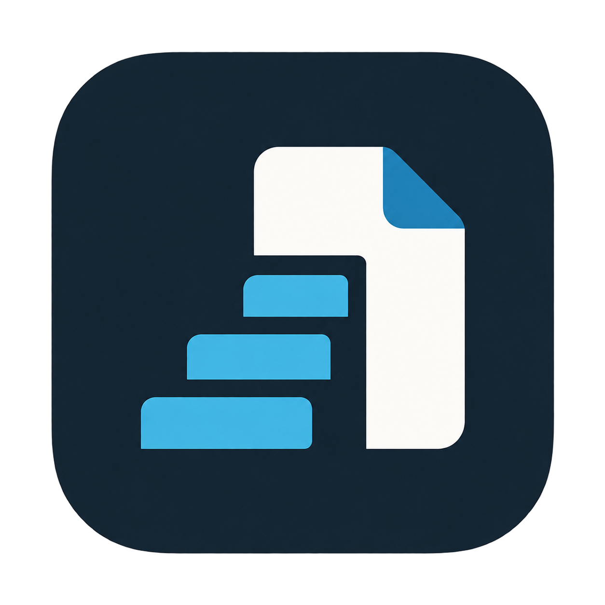
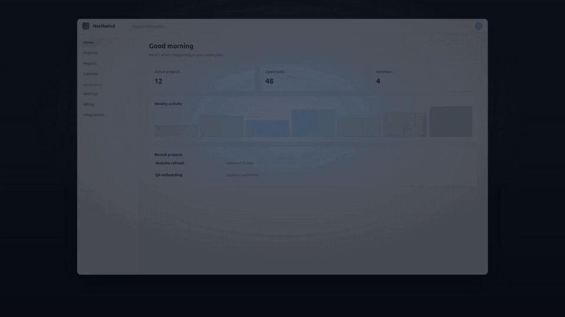

<p align="center">
  
</p>

<h1 align="center">StepForge</h1>

<p align="center">
  <strong>Do the task once. Get the step-by-step guide forever.</strong><br>
  Record your clicks, polish the steps, then export to PDF, Word, PowerPoint or Markdown,<br>
  or publish it as a web page and just send the link.<br>
  Free and open source for Windows and Linux. No account, no cloud, no telemetry.
</p>

<p align="center">
  <a href="https://github.com/Twest2/StepForge/releases/latest"></a>
  <a href="LICENSE"></a>
  
</p>

<!-- download-badges:start (kept sorted by count; see scripts/sort-download-badges.js) -->
<p align="center">
  <a href="https://github.com/Twest2/StepForge/releases"></a>
  <a href="docs/windows/chocolatey.md"></a>
  <a href="docs/linux/apt.md"></a>
  <a href="docs/linux/dnf.md"></a>
</p>
<!-- download-badges:end -->

<p align="center">
  <a href="https://github.com/Twest2/StepForge/releases/latest"><strong>Download</strong></a> ·
  <a href="docs/GETTING_STARTED.md"><strong>Getting started</strong></a> ·
  <a href="#share-a-guide-with-a-web-link"><strong>Share with a link</strong></a> ·
  <a href="docs/windows_installation.md"><strong>See a real guide made with it</strong></a> ·
  <a href="https://stepforge.twestbrook.com"><strong>Website</strong></a>
</p>

<p align="center">
  <a href="docs/media/stepforge-demo.mp4"></a><br>
  <sub><a href="docs/media/stepforge-demo.mp4">Watch the full-quality video (MP4)</a></sub>
</p>

---

Writing a how-to guide usually means doing the task, stopping to take a
screenshot, cropping it, pasting it into a document, typing "click here", and
repeating that twenty times.

**StepForge does that part for you.** Start a recording and work normally.
Every click becomes a step: a screenshot of the screen at the moment you
clicked, a marker on exactly where you clicked, and a title it reads off the
button or menu you clicked ("Click Save"). When you're done, tidy up the steps
in the editor and export a finished guide.

It's built for anyone who explains anything to other people: IT and help desk
teams writing SOPs and runbooks, trainers and teachers, support teams answering
"how do I…?", and developers documenting setup steps.

> **Looking for a Steps Recorder replacement?** Microsoft has deprecated the
> Windows Steps Recorder (`psr.exe`). StepForge records the same way, click by
> click, and turns the result into a guide you can edit and share instead of a
> zipped web page. It's also a free, open-source alternative to tools like
> Scribe, Tango and Folge.

## Why StepForge

- **Free, for real.** No trial, no seat limits, no watermark, no paid tier.
  Apache 2.0, including for commercial use.
- **Your screenshots stay on your computer.** No account, no upload, no
  telemetry. Recording, editing, OCR and export all work offline.
- **Private details get blurred.** Before you publish, StepForge checks every
  screenshot for email addresses, card numbers, passwords, API keys and more,
  and blurs them.
- **Send a link, not a file.** Publish any guide as a web page in one click,
  hosted free on your own GitHub. [More below](#share-a-guide-with-a-link).
- **Export to what your team already uses.** PDF, Word, PowerPoint, Markdown,
  HTML, Confluence, Wiki.js and more, so a guide lands where people will read it.

## Share a guide with a web link

Nobody wants a 40-page PDF attachment. Choose **Share → Publish to the web…**,
pick how long it should stay up, and StepForge turns the guide into a live web
page and hands you a link to send. It's usually online in under a minute.

- **Free hosting you own.** Guides are published with
  [GitHub Pages](https://pages.github.com) to a repository in *your* GitHub
  account. StepForge doesn't run a server and never hosts your guides, so
  there's no subscription and nothing to shut down.
- **It cleans up after itself.** Every shared guide expires after 1, 7 or 30
  days and is removed automatically, even if StepForge is closed. Need it
  longer? **Extend** it. Done early? **Remove** it.
- **A page people actually follow.** Readers get an interactive checklist: a
  contents sidebar, steps they can tick off as they go (saved in their
  browser), and screenshots that zoom to full size with a click.
- **The same link, always up to date.** Changed the guide? Publish again and
  the link stays the same. StepForge marks guides you've **edited since you
  shared them**, so you never send out a stale version.
- **Checked before it goes public.** Screenshots are scanned for email
  addresses, passwords, keys and card numbers, and those are blurred before
  anything is uploaded.
- **Hard to stumble on.** Every link has a random ID, and pages ask search
  engines not to index them. Want links on `guides.yourdomain.com`? Point a
  [custom domain](docs/GITHUB_PAGES.md#use-your-own-domain) at it and
  StepForge uses it everywhere.
- **Two-minute setup.** Sign in with GitHub and pick a repository. StepForge
  creates the site and the clean-up job for you, and never sees your GitHub
  password.

> [!IMPORTANT]
> Shared guides are **public**: anyone with the link can open them. The
> privacy check catches a lot, but always look over your screenshots before
> publishing. [How sharing works](docs/GITHUB_PAGES.md)

## Install

| Platform | Recommended | Guide |
| --- | --- | --- |
| **Windows 10 / 11** (64-bit) | Microsoft Store, Chocolatey, or the `.exe` | [Microsoft Store](docs/windows/microsoft-store.md) · [Chocolatey](docs/windows/chocolatey.md) · [Windows](docs/windows_installation.md) |
| **Ubuntu 26.04** | APT repository | [Ubuntu](docs/linux/apt.md) |
| **Fedora 44 Workstation** | DNF repository | [Fedora](docs/linux/dnf.md) |
| **Other Linux** | Portable `.tar.gz` | [Linux overview](docs/linux/linux_install.md) |

Every build is also on the [Releases page](https://github.com/Twest2/StepForge/releases/latest).
The Microsoft Store updates StepForge automatically. Installing through
Chocolatey, APT or DNF keeps StepForge up to date with the rest of your system,
and with Chocolatey, **Settings → About → Update now** installs a new version
in one click.

**Windows:** open [StepForge in the Microsoft Store](https://apps.microsoft.com/detail/9NDH81CF1HGV)
and click **Get**.

<a href="https://apps.microsoft.com/detail/9NDH81CF1HGV"></a>

<details>
<summary><strong>Windows (Chocolatey)</strong> commands</summary>

From an Administrator PowerShell:

```powershell
choco source add --name=stepforge --source=https://packages.twestbrook.com/nuget/stepforge-choco/
choco install stepforge --source=stepforge -y
```

</details>

<details>
<summary><strong>Ubuntu 26.04</strong> commands</summary>

```bash
sudo mkdir -p /etc/apt/keyrings
sudo curl -fsSL -o /etc/apt/keyrings/stepforge.gpg \
  https://packages.twestbrook.com/debian/stepforge/keys/stepforge.gpg
echo "deb [arch=amd64 signed-by=/etc/apt/keyrings/stepforge.gpg] https://packages.twestbrook.com/debian/stepforge/ resolute main" \
  | sudo tee /etc/apt/sources.list.d/stepforge.list
sudo apt update && sudo apt install stepforge
```

</details>

<details>
<summary><strong>Fedora 44</strong> commands</summary>

```bash
sudo tee /etc/yum.repos.d/stepforge-rpm.repo > /dev/null <<'EOF'
[stepforge-rpm]
name=StepForge RPM Repository
baseurl=https://packages.twestbrook.com/rpm/stepforge-rpm/
enabled=1
gpgcheck=0
EOF

sudo dnf makecache --refresh
sudo dnf install stepforge
```

</details>

## Your first guide in one minute

1. Open StepForge and choose **New guide**.
2. Choose **Capture → Start capture session**. StepForge steps out of the way.
3. Do the task you want to document, clicking as you normally would.
4. Stop the recording from the tray icon (Windows) or **StepForge REC** in the
   GNOME top panel (Linux).
5. Tidy up titles, add annotations, then choose **Export**.

The [Getting Started guide](docs/GETTING_STARTED.md) walks through recording,
editing and exporting in more detail. Want to see the result first? The
[Windows installation guide](docs/windows_installation.md) in this repository
was recorded with StepForge.

## Features

**Record**

- **Click-to-step capture.** Each click captures the screen *as it was when you
  clicked* and marks the spot. Fast clicks are never dropped.
- **Smart titles.** Local OCR reads what you clicked, so steps arrive titled
  "Click Save", "Right-click Report.xlsx" or "Double-click Report.xlsx".
- **Retake or swap a screenshot** later when the software changes, keeping the
  step's text and annotations.

**Edit**

- **Three-pane editor.** Steps on the left, the screenshot in the middle, the
  words on the right. Reorder, nest substeps, and mark steps as done.
- **Annotations.** Rectangles, ovals, arrows, text, tooltips, numbered badges,
  highlights, magnifiers, and **blur** for passwords and personal data.
- **Notes, tips, warnings, code blocks and tables** in any step. Code blocks
  are syntax-highlighted on export, in Atom One Dark or seven other themes.
- **Reusable content.** Placeholders (`[[Product]]`) and export templates keep
  a whole set of guides consistent.
- **Your branding.** Brand profiles put your logo, colors, fonts, cover style,
  header and footer on every export: HTML, PDF, Word, PowerPoint and the rest.
- **Organized library.** Folders, favorites, full-text search across every
  guide, snapshots, and a trash you can restore from.

**Share**

- **Export anywhere.** PDF, DOCX, PPTX, Markdown, HTML, an interactive
  checklist page, animated GIF, Confluence, Wiki.js, JSON, or a folder of
  annotated images.
- **Share a link.** Publish a guide as an interactive web page on your own
  GitHub Pages site for 1, 7 or 30 days, removed automatically when its time
  is up. [See how it works](#share-a-guide-with-a-link).
- **Publish to Confluence** (beta) on Confluence Cloud or your organization's
  Data Center site, including sites that need a smart card (CAC).
- **Publish to Wiki.js** (beta), with the screenshots uploaded to the wiki.
- **Six languages.** English, plus French, Spanish, Russian, Simplified
  Chinese and Japanese (beta). StepForge follows your system language, or
  pick one in **Settings → General → Language**. Exported guides stay in
  English.

**Optional, and off until you turn them on**

- **Sync** between computers with Google Drive, OneDrive, Dropbox or Nextcloud.
- **AI that writes whole guides** through a model on your own computer with
  [Ollama](https://ollama.com).
- **[Claude or Codex](docs/AI_AGENTS.md)** as guide writers, through MCP.

## Privacy

StepForge works entirely on your computer.

- **No accounts, no telemetry, no analytics,** no license checks, and no
  automatic update checks (you can check for updates yourself in
  **Settings → About**).
- Capture, editing, OCR and export all work offline.
- Cloud sync, sharing, publishing and AI are **off by default** and only
  connect when you turn them on. AI talks to a model on your own machine
  unless you explicitly allow a remote host. AI agents such as Claude or Codex
  send what they read to their own provider.

The [privacy policy](docs/PRIVACY.md) lists exactly what is stored and what
each optional feature sends.

## Documentation

**Using StepForge**

- [Getting started](docs/GETTING_STARTED.md): recording, editing and exporting
- [AI-written guides with Ollama](docs/getting_started_with_ai.md)
- [Let Claude or Codex write your guides](docs/AI_AGENTS.md)
- [Google Drive sync](docs/GOOGLE_DRIVE.md) · [OneDrive, Dropbox or Nextcloud](docs/CLOUD_ACCOUNTS.md)
- [Share guides on the web with GitHub Pages](docs/GITHUB_PAGES.md)
- [Publish to Confluence](docs/CONFLUENCE.md) · [Publish to Wiki.js](docs/WIKIJS.md)
- [Brand your exported guides](docs/BRANDING.md): logos, colors, fonts and Advanced CSS
- [Privacy](docs/PRIVACY.md) and [security](docs/SECURITY.md)

**Installing**

- [Microsoft Store](docs/windows/microsoft-store.md) · [Windows installer](docs/windows_installation.md) · [Chocolatey](docs/windows/chocolatey.md)
- [Linux overview](docs/linux/linux_install.md) · [Ubuntu](docs/linux/apt.md) · [Fedora](docs/linux/dnf.md)

**Contributing**

- [Contributing guide](docs/CONTRIBUTING.md) · [Architecture](docs/ARCHITECTURE.md) · [Code of conduct](docs/CODE_OF_CONDUCT.md)

## Getting help

- **Found a bug or have an idea?** [Open an issue](https://github.com/Twest2/StepForge/issues/new/choose).
- **Security problem?** Email `git@twestbrook.com` privately rather than
  opening a public issue. See [SECURITY.md](docs/SECURITY.md).

## Contributing

Contributions are welcome. Every pull request is linked to an issue and comes
with tests; the [contributing guide](docs/CONTRIBUTING.md) covers the workflow,
how to run StepForge from source, and the test suite (`bash tests/run_test.sh`).

**If StepForge saves you time, a ⭐ on GitHub helps other people find it.**

## License

StepForge is released under the [Apache License 2.0](LICENSE). You can use,
modify and share it for free for any purpose, including commercial use, as
long as you keep the copyright and license notices.

StepForge is an independent project. It isn't affiliated with Microsoft,
Scribe, Tango or Folge, and contains no code, branding or assets from any
commercial documentation tool.
