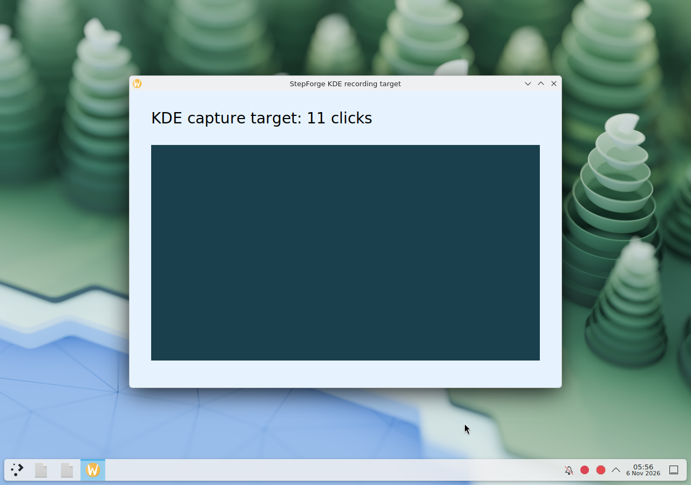
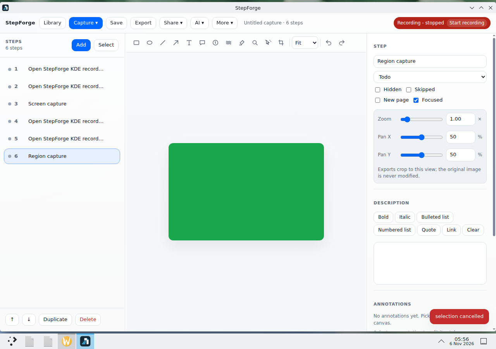

# Plasma desktop validation for PR #272

Tested commit: 3655f75bf1f63af036ad87d47de3b9c6dfa3307c.

Installed the rebuilt Debian package into a disposable Ubuntu 26.04 container running full Plasma 6.6.6, Qt 6.10.2, a real KWin Wayland session, Mesa llvmpipe and PipeWire. The scenario passed with six persisted steps.

- Native monitor sharing and the Plasma recording reminder.
- Fullscreen 1280×900 capture, actual pre-click pixels, window title and normalized click-marker position.
- Ctrl+Alt+C capture; Ctrl+Alt+P pause and resume; no step while paused; right-click recording after resume.
- Tray Pause and Finish, excluding the tray and menu clicks from the guide.
- Window capture: 800×578, correct target title.
- Native Spectacle region selection: 401×251; cancellation adds no step.
- Unit suite: 1,393 passed, zero failed, 24 platform/tool skips. All five translations complete.

The real GTK target changes color on each click. Native Wayland input controls the desktop and KDE dialogs; trusted CDP mouse events operate the app UI. A private mouse FIFO and discovery table supply the device boundary, while the production portal, PipeWire, KWin script, input decoder, cropping and disk persistence execute normally. No host mouse or desktop is accessed. Physical touchpad hardware, local-seat ACL grants and mixed-scale physical monitors are outside this run. Existing package/helper tests cover the rules and event/geometry handling.

The test found and fixed non-firing default shortcuts, hidden-window startup on native Wayland, portal reactivation over the recording target, Finish not restoring a hidden window, and a spurious missing-window notice on discarded tray clicks. Saved shortcut choices are preserved.

The repeatable test fixture is in tests/integration/linux/kde-desktop on the PR branch. See desktop-test-results.json and desktop-test.log for the actual run.

