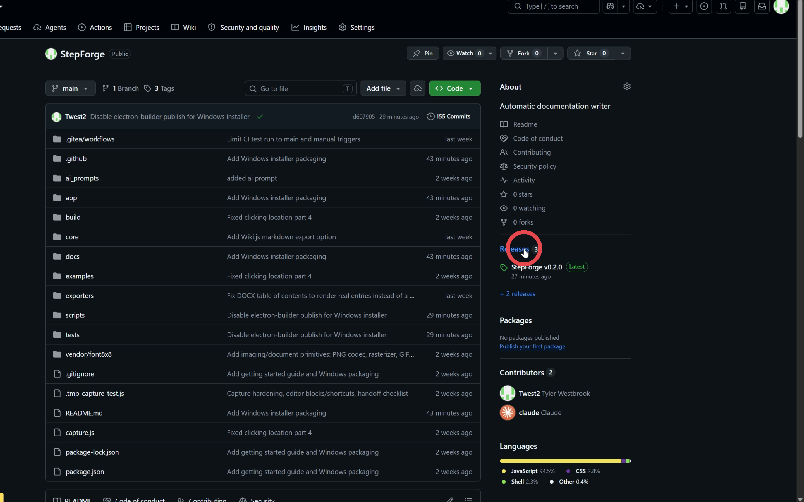
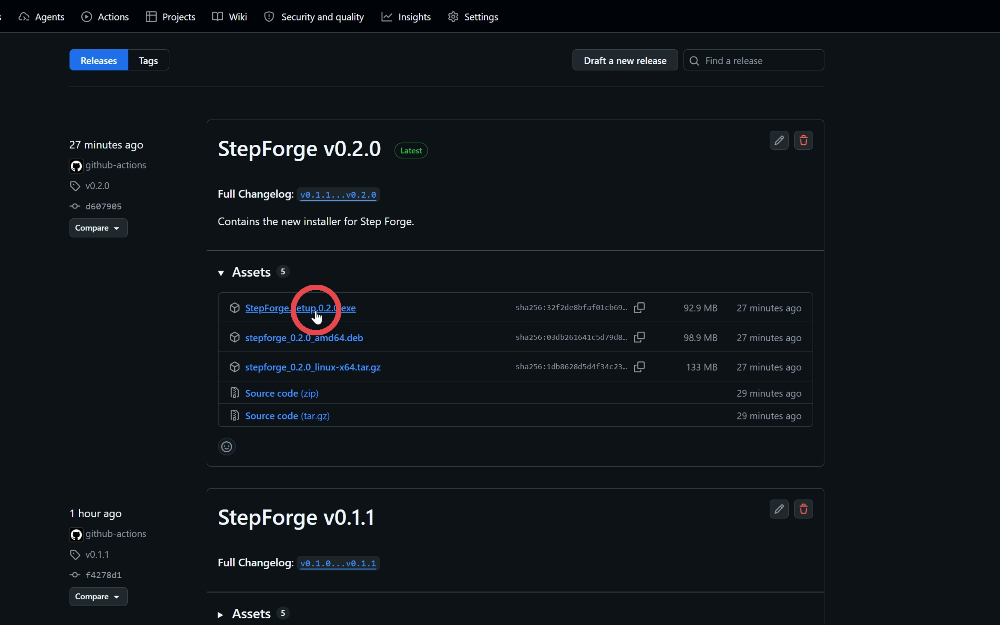
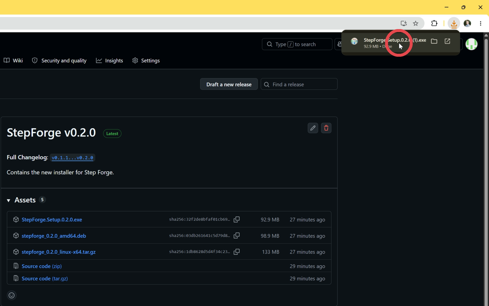
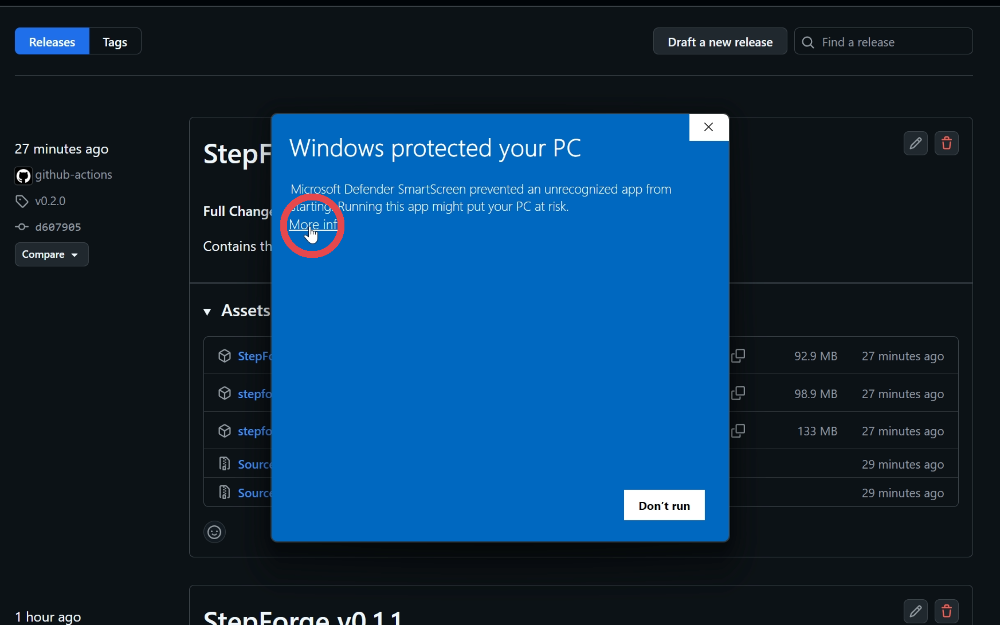
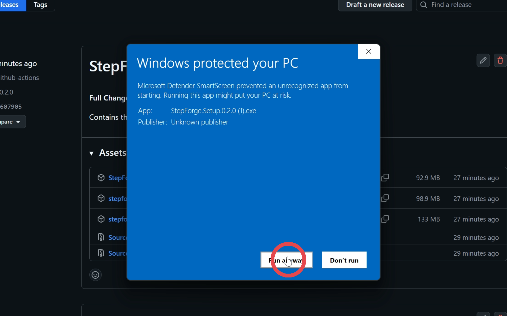
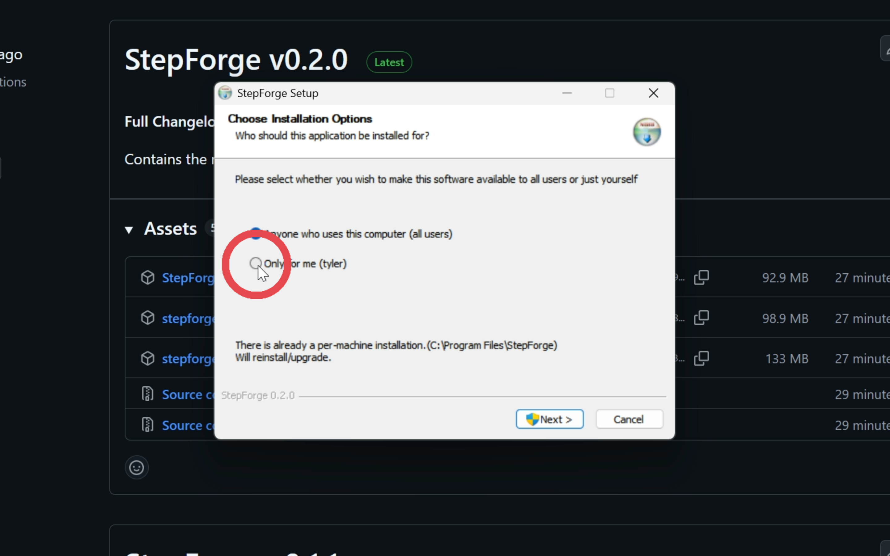
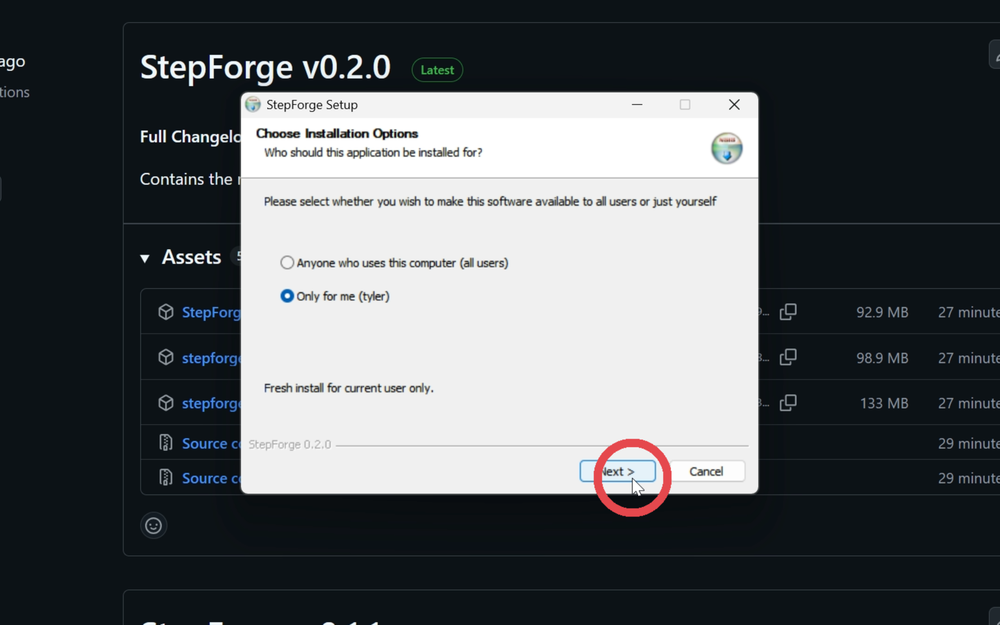
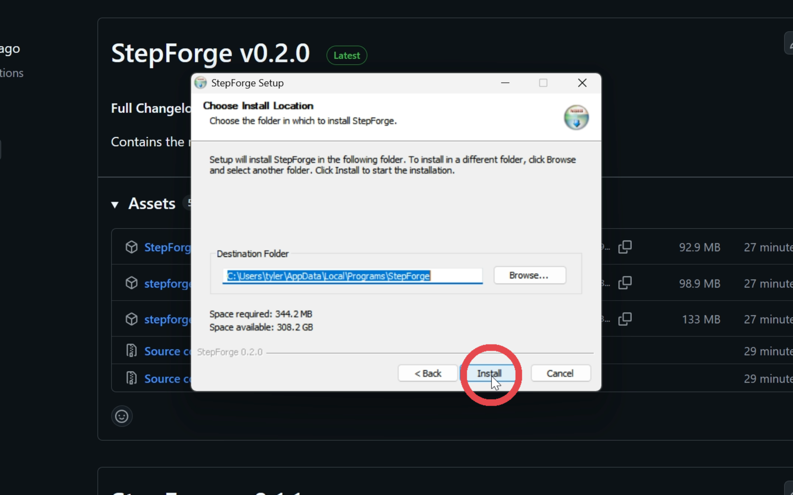
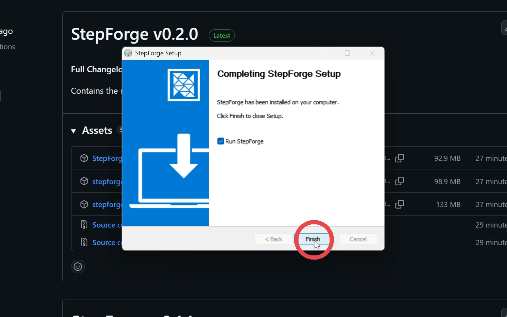

# Install StepForge on Windows

StepForge runs on **Windows 10 and Windows 11 (64-bit)**. There are three ways
to install it:

| | Updates | Windows warning | Administrator rights |
| --- | --- | --- | --- |
| **[Microsoft Store](windows/microsoft-store.md)** (recommended) | Automatic, from the Store | None | Not needed |
| **[Chocolatey](windows/chocolatey.md)** | **Update now** in Settings → About, or `choco upgrade stepforge` | None | Needed |
| **The `.exe` installer** (this page) | **Update now**, if you let it set up Chocolatey | **Windows protected your PC**, the first time | Needed for Chocolatey updates or an all-users install |

## Recommended: the Microsoft Store

1. Open [StepForge in the Microsoft Store](https://apps.microsoft.com/search?query=StepForge),
   or search for **StepForge** in the **Microsoft Store** app.
2. Click **Get**, then **Open**.

That's it. The Store keeps StepForge up to date, and your guides are kept in
a **StepForge** folder in your user folder (`%USERPROFILE%\StepForge`).
Switching from the `.exe` installer, or want the details? See
[Install StepForge from the Microsoft Store](windows/microsoft-store.md).

## Or use the .exe installer

Use the installer if the Microsoft Store isn't available, for example on a
work PC where your organization has turned it off. Installing takes about two
minutes.

> [!TIP]
> The installer's **Updates** page (checked by default) sets up
> [Chocolatey](windows/chocolatey.md) for you, so **Settings → About → Check
> for updates → Update now** and `choco upgrade stepforge` work afterwards.

*These instructions were recorded and exported with StepForge itself. The
red circles mark where to click.*

## 1. Download the installer

**1.1** Open the [StepForge repository on GitHub](https://github.com/Twest2/StepForge).

**1.2** In the right-hand sidebar, click **Releases**.

**1.3** Open the release marked **Latest** and, under **Assets**, download
the file named `StepForge.Setup.<version>.exe`.

> [!NOTE]
> Or skip straight to the [latest release](https://github.com/Twest2/StepForge/releases/latest).

## 2. Run the installer

**2.1** Open the file you downloaded.

**2.2** If Windows shows **Windows protected your PC**, click **More info**.

> [!IMPORTANT]
> Microsoft Defender SmartScreen shows this warning for new applications that
> haven't yet built up download reputation. It doesn't mean a problem was found
> with StepForge. Only continue if you downloaded the installer from the
> official GitHub Releases page.

**2.3** Click **Run anyway**.

**2.4** Choose whether to install StepForge **only for you** or **for all
users** of this computer. Installing for all users needs administrator rights.

**2.5** Click **Next** to keep the default install location.

**2.6** On the **Desktop Icon** page, click **Next**. On the **Updates**
page, leave **Keep StepForge updated with Chocolatey** checked to be able to
update with **Update now** in Settings → About, or `choco upgrade stepforge`,
later (see
[Already installed from the .exe?](windows/chocolatey.md#already-installed-from-the-exe)),
then click **Install**. If you install only for yourself, Windows asks for
administrator approval once for this; if you decline, StepForge is still
installed. Installing only for yourself becomes an all-users install on the
first Chocolatey update.

**2.7** Click **Finish**. StepForge opens and is ready to use.

## Next steps

- Record your first guide with the [Getting Started guide](GETTING_STARTED.md).
- StepForge appears in the Start menu as **StepForge**.

## Updating and uninstalling

These are for the `.exe` installer. For the Store version, see
[Updates](windows/microsoft-store.md#updates) and
[Uninstall](windows/microsoft-store.md#uninstall).

**To update,** open **Settings → About** and press **Check for updates**. If
you left the Chocolatey option on during setup, press **Update now**: StepForge
closes, installs the new version with Chocolatey after you approve the
administrator prompt, and opens again (or run `choco upgrade stepforge -y`
yourself, see [Update](windows/chocolatey.md#update)). Otherwise, download the
newest installer from
[Releases](https://github.com/Twest2/StepForge/releases/latest) and run it;
keep **Keep StepForge updated with Chocolatey** checked to get **Update now**
from then on. Your guides and settings are kept either way.

**To uninstall,** open **Settings → Apps → Installed apps**, find
**StepForge**, and choose **Uninstall**. Your guides stay in
`%APPDATA%\stepforge` in case you reinstall. Delete that folder if you want
them gone too.
